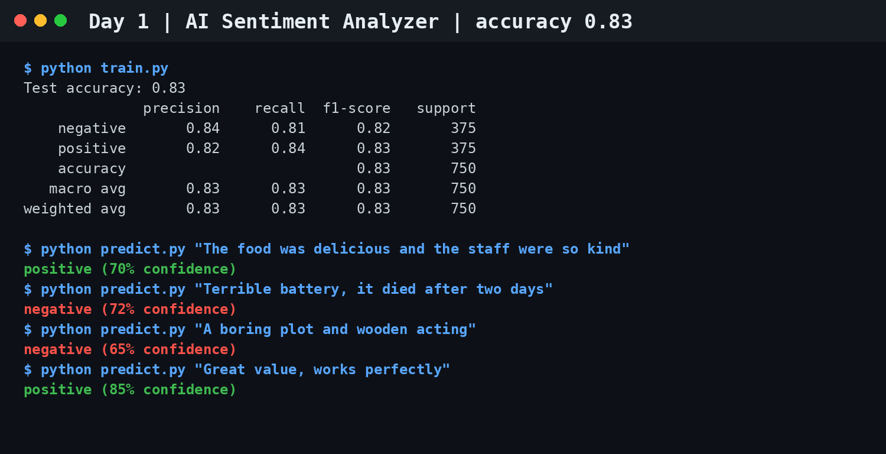

# AI Sentiment Analyzer

Day 1 of my daily AI project challenge.

A small Python tool that reads a review and says if it is positive or negative. It uses TF-IDF features (words and word pairs) with logistic regression from scikit-learn.



## Results

Trained on 3,000 labelled sentences (75% train, 25% test, seed 42).
Test accuracy: **0.83** (precision and recall about 0.82 to 0.84 for both classes).

## Run it

```bash
pip install -r requirements.txt
python train.py
python predict.py "the food was great and the staff were kind"
```

## Data

`reviews.csv` combines the "Sentiment Labelled Sentences" dataset (IMDB, Amazon and Yelp, 1,000 sentences each) from the UCI Machine Learning Repository.
Kotzias et al., "From Group to Individual Labels using Deep Features", KDD 2015.

## Ideas to improve it

- Try Naive Bayes or a linear SVM and compare.
- Add a confusion matrix plot.
- Handle negation ("not good") better.
